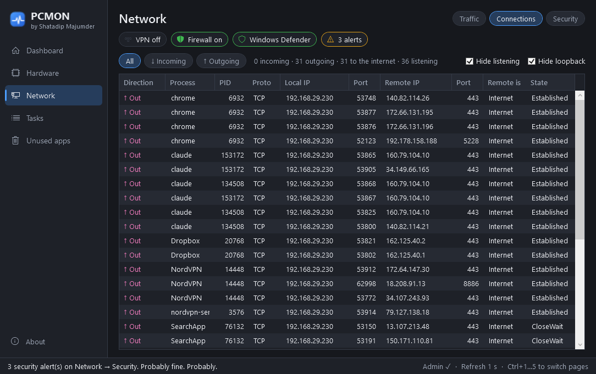
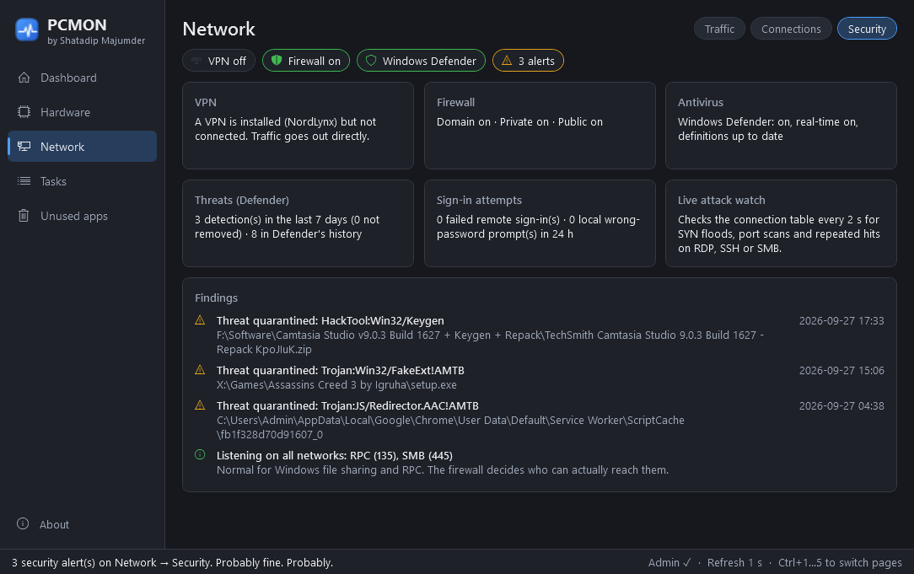

# PCMON 🖥️🩺

*by Shatadip Majumder*

**Your PC's vital signs, minus the hospital bill.**

PCMON is a small, portable Windows dashboard. It shows:

- hardware sensors (like HWMonitor), with CPU and GPU temperatures in °C up front
- live network speed, incoming and outgoing connections, VPN status, and an attack watch
- running and stopped tasks
- apps you forgot you installed, with a button to uninstall them

There's one `.exe` and no installer. Double-click it and it runs.


## Download

Get **`PCMON.exe`** from the [latest release](https://github.com/shatadip/PCMon/releases/latest). It runs on Windows 10 22H2+ and Windows 11, x64. It's self-contained, so you don't need to install .NET.

Windows will ask for admin rights when it starts (see [Why does it need admin?](#why-does-it-need-admin)).

## What's inside

| Page | What it shows |
|---|---|
| **Dashboard** | Tiles for CPU, GPU, memory and network, each with a 60-second sparkline. CPU and GPU tiles lead with **temperature in °C**, with load % underneath and both plotted on the sparkline. The network tile shows VPN on/off and any security alerts. A green/amber/red border shows status, with ⚠ icons when something is off. A Storage card has a usage bar for every drive. Top 5 lists show the processes using the most CPU and RAM. Click one to jump to it on the Tasks page. |
| **Hardware** | An HWMonitor-style tree (Device → Sensor type → Sensor) with **Current / Min / Max** values and a *Reset Min/Max* button. |
| **Network** | A status strip: **VPN** (on / off / split tunnel), **Firewall**, **Antivirus** and **Attack watch**. **Traffic**: incoming and outgoing speed and totals per adapter, plus a 2-minute chart. **Connections**: every TCP connection (IPv4 + IPv6) marked **↓ Incoming** or **↑ Outgoing**, with local IP/port, remote IP/port, whether the remote end is Internet, LAN or loopback, the owning process and its state. **Security**: firewall profiles, antivirus and definitions, Defender detections, failed sign-ins, and live attack heuristics. |
| **Tasks** | **Processes**: Running, **Not Responding** or Suspended, plus CPU, memory and path. End Task is on right-click, the button, or the Delete key. **Scheduled Tasks**: Running / Ready / Disabled, last and next run, last result. |
| **Unused apps** | Installed apps you haven't opened in 30/60/90/180 days. Tick some and click *Uninstall selected*. PCMON asks first, then runs each app's **own** uninstaller, one at a time. |

| | |
|---|---|
|  |  |
|  |  |
|  |  |

It follows your Windows theme. Here is light mode:


**Shortcuts:** Ctrl+1 … Ctrl+5 switch pages. Delete ends the selected process.

## Why does it need admin?

Hardware sensors, the Windows Prefetch data used for "last used" estimates, and the Security event log (failed sign-ins) all need elevated access. PCMON only **reads** them.

PCMON does **not**:
- make any network calls (no telemetry, no update checks, no IP lookups). VPN and attack checks use only local data.
- install services or drivers
- write anything except `%LOCALAPPDATA%\PCMon\settings.json` and a small rolling `pcmon.log`

To remove PCMON, delete the exe and that folder.

## Good to know

- **CPU temperature.** Reading Intel/AMD CPU temperatures, clocks and power uses LibreHardwareMonitor's [PawnIO](https://pawnio.eu) driver. If PawnIO isn't installed, PCMON says so on the Hardware page and falls back to the ACPI thermal zone, marked "(ACPI)" on the dashboard. PCMON never installs drivers itself. GPU, disk, memory and load sensors work without it.
- **VPN detection** recognises adapters from NordVPN, WireGuard, OpenVPN, Proton, Mullvad, Tailscale, Cisco, Fortinet, GlobalProtect and more, plus built-in Windows VPN connections. "All traffic" vs "split tunnel" comes from Windows' own routing table. PCMON never contacts a server to check your public IP.
- **The attack watch is a set of heuristics, not an antivirus.** Live checks (every 2 s): half-open SYN floods, port scans (one address touching 10+ ports in a minute), and repeated hits on RDP/SSH/SMB/VNC. Every 2 minutes: Defender detections from the last 7 days, firewall and antivirus state, and failed sign-ins from the Security log. Failed sign-ins **from another machine** (network or RDP logons) count as possible brute force. Wrong-password prompts on this PC, such as a browser asking for your Windows password, are shown as informational only.
- **"Last used" is an estimate.** It comes from Windows Prefetch and Explorer's UserAssist records. If neither has a record for an app, it shows `Unknown ¯\_(ツ)_/¯`. You can hide those with the checkbox.
- **Critical processes are protected.** `csrss`, `lsass`, `wininit`, `smss`, `services` and `System` show a lock and can't be ended. *"Nice try. Killing lsass would blue-screen us both."*

## Build it yourself

You need the .NET 8 SDK.

```bash
dotnet test PCMon.sln -c Release
```

```bash
dotnet publish src/PCMon -c Release -r win-x64 --self-contained true -p:PublishSingleFile=true -p:IncludeNativeLibrariesForSelfExtract=true -p:DebugType=none -o publish
```

This gives you `publish/PCMON.exe`, about 140 MB. Single-file compression would roughly halve the file, but the exe would then unpack itself into RAM and use about 90 MB more memory. Lower memory use wins.

Two command-line switches help with checking a build:

- `PCMON.exe --selftest report.json` samples every data source once without opening a window. It writes a JSON report with per-source timings and exits non-zero if something is broken. CI runs this on every build.
- `PCMON.exe --screenshot <dir> [--theme dark|light]` visits each page, saves PNGs and exits. That's how the screenshots above were made.

Pushing a `v*` tag builds, tests, self-tests and attaches `PCMON.exe` to a GitHub Release.

## Project layout

```
src/PCMon/
  Core/        pure logic: thresholds, formatting, heuristics, jokes (unit-tested)
  Services/    sampling: LibreHardwareMonitor, NtQuerySystemInformation, IP Helper, Task Scheduler COM, registry,
               Security Center / Defender (WMI), Security event log
  ViewModels/  MVVM (CommunityToolkit.Mvvm)
  Views/       WPF pages; Themes/ holds dark + light palettes
tests/PCMon.Tests/   xUnit: unit, view-model and integration tests
SRS.md               the spec this was built from
```

## Credits

**PCMON by Shatadip Majumder.** Sensors by [LibreHardwareMonitor](https://github.com/LibreHardwareMonitor/LibreHardwareMonitor) (MPL-2.0). Made with C#, coffee, and mild thermal anxiety.
