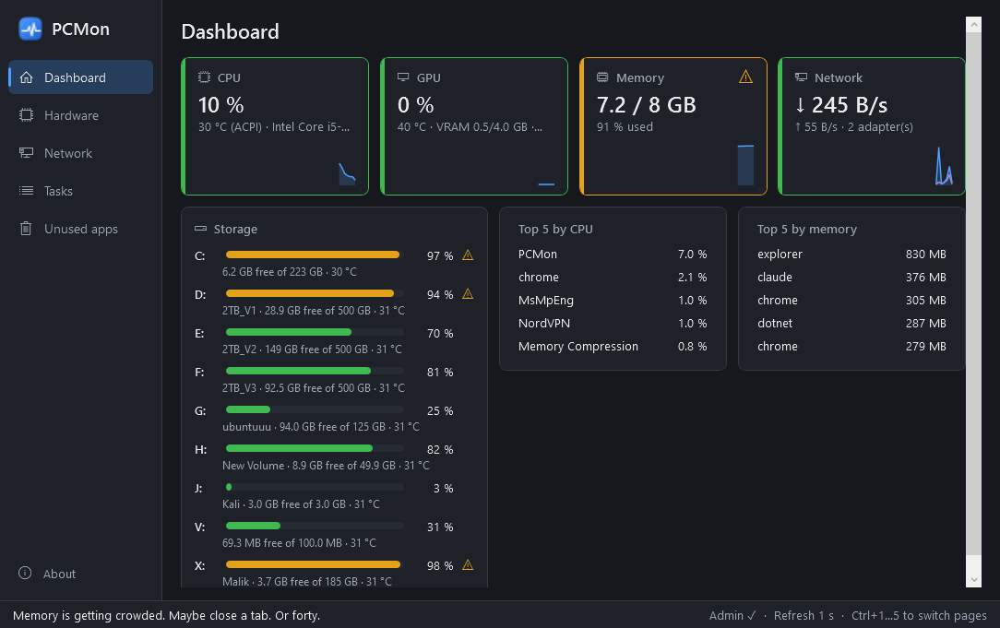
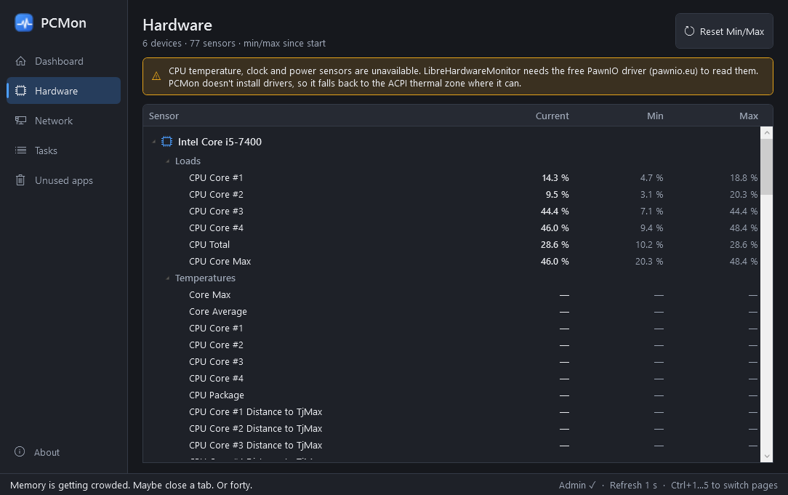
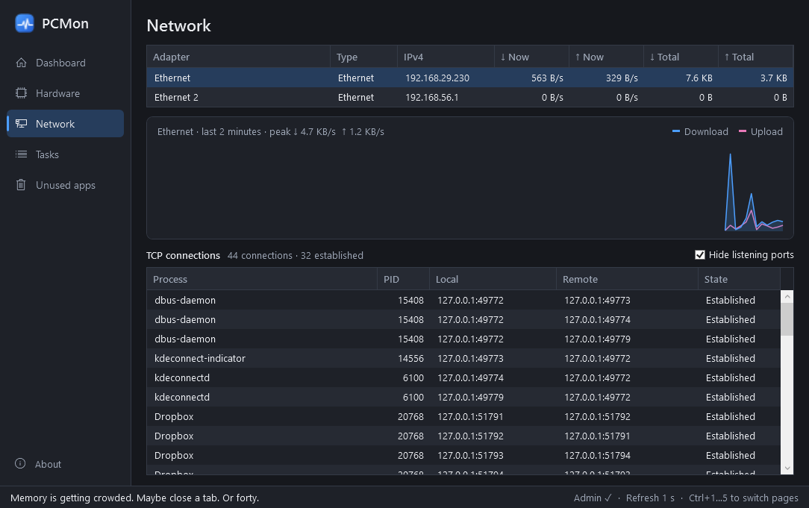
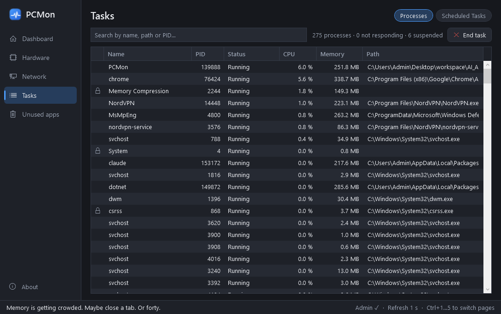
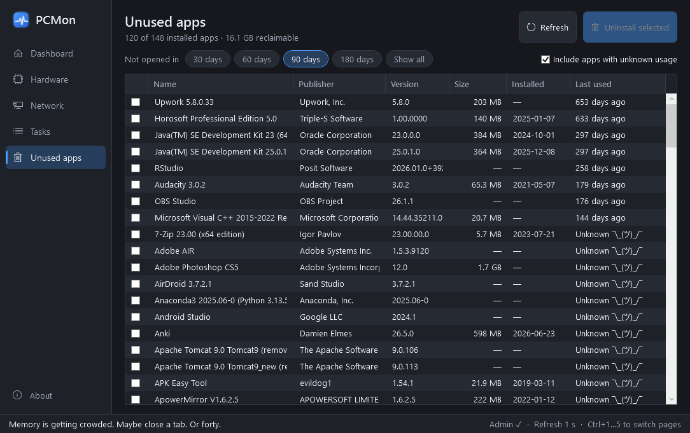
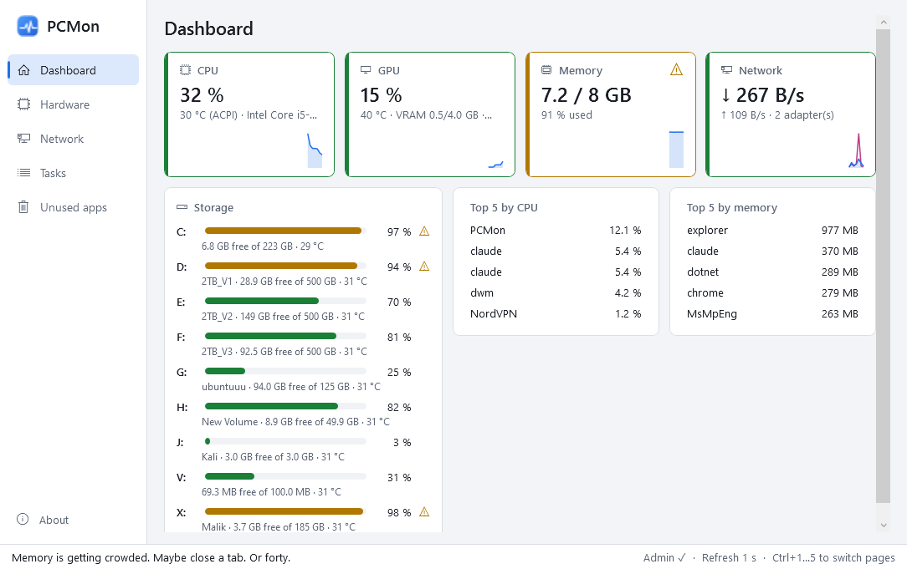

# PCMon 🖥️🩺

**Your PC's vital signs, minus the hospital bill.**

PCMon is a small, portable Windows dashboard. It shows:

- hardware sensors (like HWMonitor)
- live network speed and connections
- running and stopped tasks
- apps you forgot you installed, with a button to uninstall them

There's one `.exe` and no installer. Double-click it and it runs.



## Download

Get **`PCMon.exe`** from the [latest release](https://github.com/shatadip/PCMon/releases/latest). It runs on Windows 10 22H2+ and Windows 11, x64. It's self-contained, so you don't need to install .NET.

Windows will ask for admin rights when it starts (see [Why does it need admin?](#why-does-it-need-admin)).

## What's inside

| Page | What it shows |
|---|---|
| **Dashboard** | Tiles for CPU, GPU, memory and network, each with a 60-second sparkline. A green/amber/red border shows status, with ⚠ icons when something is off. A Storage card has a usage bar for every drive. Top 5 lists show the processes using the most CPU and RAM. Click one to jump to it on the Tasks page. |
| **Hardware** | An HWMonitor-style tree (Device → Sensor type → Sensor) with **Current / Min / Max** values and a *Reset Min/Max* button. |
| **Network** | Live and total ↓/↑ per adapter, a 2-minute traffic chart, and the TCP connections table with the owning process. |
| **Tasks** | **Processes**: Running, **Not Responding** or Suspended, plus CPU, memory and path. End Task is on right-click, the button, or the Delete key. **Scheduled Tasks**: Running / Ready / Disabled, last and next run, last result. |
| **Unused apps** | Installed apps you haven't opened in 30/60/90/180 days. Tick some and click *Uninstall selected*. PCMon asks first, then runs each app's **own** uninstaller, one at a time. |

| | |
|---|---|
|  |  |
|  |  |

It follows your Windows theme. Here is light mode:



**Shortcuts:** Ctrl+1 … Ctrl+5 switch pages. Delete ends the selected process.

## Why does it need admin?

Hardware sensors and the Windows Prefetch data used for "last used" estimates both need elevated access. PCMon only **reads** them.

PCMon does **not**:
- make any network calls (no telemetry, no update checks)
- install services or drivers
- write anything except `%LOCALAPPDATA%\PCMon\settings.json` and a small rolling `pcmon.log`

To remove PCMon, delete the exe and that folder.

## Good to know

- **CPU temperature.** Reading Intel/AMD CPU temperatures, clocks and power uses LibreHardwareMonitor's [PawnIO](https://pawnio.eu) driver. If PawnIO isn't installed, PCMon says so on the Hardware page and falls back to the ACPI thermal zone, marked "(ACPI)" on the dashboard. PCMon never installs drivers itself. GPU, disk, memory and load sensors work without it.
- **"Last used" is an estimate.** It comes from Windows Prefetch and Explorer's UserAssist records. If neither has a record for an app, it shows `Unknown ¯\_(ツ)_/¯`. You can hide those with the checkbox.
- **Critical processes are protected.** `csrss`, `lsass`, `wininit`, `smss`, `services` and `System` show a lock and can't be ended. *"Nice try. Killing lsass would blue-screen us both."*

## Build it yourself

You need the .NET 8 SDK.

```bash
dotnet test PCMon.sln -c Release
```

```bash
dotnet publish src/PCMon -c Release -r win-x64 --self-contained true -p:PublishSingleFile=true -p:IncludeNativeLibrariesForSelfExtract=true -p:EnableCompressionInSingleFile=true -p:DebugType=none -o publish
```

This gives you `publish/PCMon.exe`, about 65 MB.

Two command-line switches help with checking a build:

- `PCMon.exe --selftest report.json` samples every data source once without opening a window. It writes a JSON report with per-source timings and exits non-zero if something is broken. CI runs this on every build.
- `PCMon.exe --screenshot <dir> [--theme dark|light]` visits each page, saves PNGs and exits. That's how the screenshots above were made.

Pushing a `v*` tag builds, tests, self-tests and attaches `PCMon.exe` to a GitHub Release.

## Project layout

```
src/PCMon/
  Core/        pure logic: thresholds, formatting, heuristics, jokes (unit-tested)
  Services/    sampling: LibreHardwareMonitor, NtQuerySystemInformation, IP Helper, Task Scheduler COM, registry
  ViewModels/  MVVM (CommunityToolkit.Mvvm)
  Views/       WPF pages; Themes/ holds dark + light palettes
tests/PCMon.Tests/   xUnit: unit, view-model and integration tests
SRS.md               the spec this was built from
```

## Credits

Sensors by [LibreHardwareMonitor](https://github.com/LibreHardwareMonitor/LibreHardwareMonitor) (MPL-2.0). Made with C#, coffee, and mild thermal anxiety.
